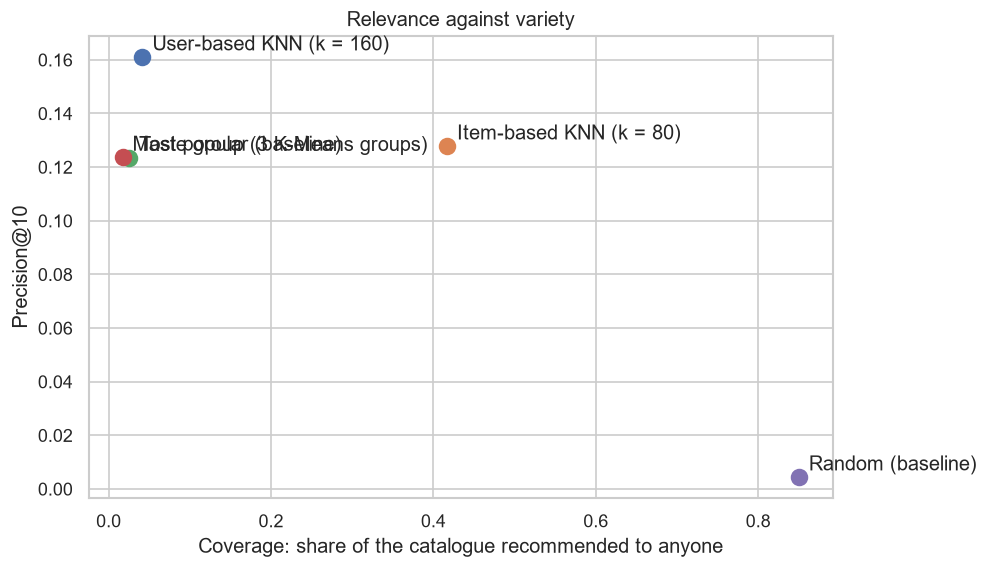

<div align="center">

<h1>Movie recommender</h1>

<p>Movie recommendations with user- and item-based K-nearest neighbours, and user grouping with K-Means, on 100,836 MovieLens ratings. Each method is scored on ratings it never saw: did it recommend movies the user went on to rate 4 stars or more? An interactive demo recommends movies for any MovieLens user or for movies you pick.</p>

<p>
<a href="https://github.com/pxnz3r/movie-recommender/actions/workflows/ci.yml"></a>

<a href="LICENSE"></a>
</p>

<p><a href="docs/results.md">Results</a> · <a href="docs/methodology.md">Methodology</a> · <a href="docs/deploy.md">Deploy the demo</a></p>



</div>

## How it works

1. **Hide 20%** of every user's MovieLens ratings.
2. **Recommend 10 movies** per user with user-based and item-based KNN, K-Means taste groups and two baselines.
3. **Score each method** on the hidden ratings: precision, recall, hit rate and coverage.
4. **Test how sure the scores are** with bootstrap intervals over users, and check popularity bias and how light users fare.
5. **Pick a user, or movies you like,** in the Streamlit demo and get recommendations.

## Results

20% of each user's ratings are hidden; 10 recommendations per user; 597 users have at least one hidden 4-star rating to find.

| Method | Precision@10 | Recall@10 | Hit rate | Coverage |
| --- | --- | --- | --- | --- |
| User-based KNN (160 neighbours) | **0.161** | **0.151** | **68%** | 4% |
| Item-based KNN (80 neighbours) | 0.128 | 0.113 | 59% | 42% |
| Taste group (K-Means, 3 groups) | 0.124 | 0.109 | 58% | 3% |
| Most popular (baseline) | 0.124 | 0.108 | 57% | 2% |
| Random (baseline) | 0.004 | 0.003 | 4% | 85% |

- **User-based KNN** is the most relevant: 1.6 of its 10 recommendations are movies the user rated 4 stars or more, against 1.2 for the most popular movies.
- **Item-based KNN** is a little less relevant but far more varied: it recommends 42% of the 3,222-movie catalogue at least once, against 4% for user-based KNN.
- **Taste groups** (K-Means on each user's genre shares) match the popularity baseline but no more: three broad groups share the same favourite classics. As a description they are clear: Comedy & Romance fans 41%, Thriller & Crime fans 38%, Adventure & Action fans 21%.
- The number of neighbours was chosen on a validation split carved from the training ratings, never on the hidden test ratings.

Full tables and figures: [docs/results.md](docs/results.md). How it was done: [docs/methodology.md](docs/methodology.md).

## How sure the results are

**User-based KNN wins, and not by luck.** Precision@10 0.161 (95% interval over users 0.146 to 0.175) against 0.124 (0.112 to 0.137) for recommending the most popular movies.

**Item-based KNN and taste groups only tie with popularity.** Their intervals overlap the popularity baseline.

**Most methods only recommend blockbusters.** 99.6% of user-based picks come from the top 10% most-rated movies. Item-based KNN is the exception: 57% blockbusters, and it shows 42% of the long tail.

**Light users are the hard case.** User-based precision@10 is 0.056 for users with 16 to 28 ratings and 0.326 for users with more than 135.

Every table and figure behind these is in [docs/results.md](docs/results.md).

## Run it

Needs Python 3.14+ and [uv](https://docs.astral.sh/uv/).

```bash
uv sync
uv run python main.py
uv run streamlit run app.py
```

`main.py` and the demo download MovieLens on their first run. `main.py` writes figures and tables to `outputs/`, the chosen settings and taste groups to `models/` and `docs/results.md`.

## The demo

- **Overview**: the methods and what was found.
- **Recommend**: pick a MovieLens user to see their highest-rated movies next to both KNN lists, or pick movies you like and get item-based recommendations.
- **Taste groups**: the K-Means groups and their favourite movies.
- **Results**: the saved tables and figures.

## Layout

```
movie_recommender/   data.py (download, split), recommend.py (the recommenders and scoring),
                     groups.py (taste groups), report.py
pxlab/               shared engine (vendored): clustering, plots, app helpers
main.py              the full study
app.py               the Streamlit demo
docs/                methodology, results, deploy
```

## Data

MovieLens "latest small" by [GroupLens Research](https://grouplens.org/datasets/movielens/) (F. Maxwell Harper and Joseph A. Konstan, "The MovieLens Datasets: History and Context", ACM TiiS 5(4), 2015). Used under its license for non-commercial research and teaching; the data isn't stored in this repo.

## License

MIT for the code.
