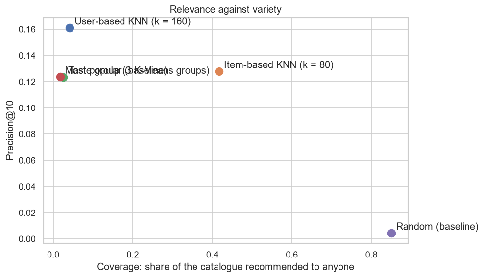
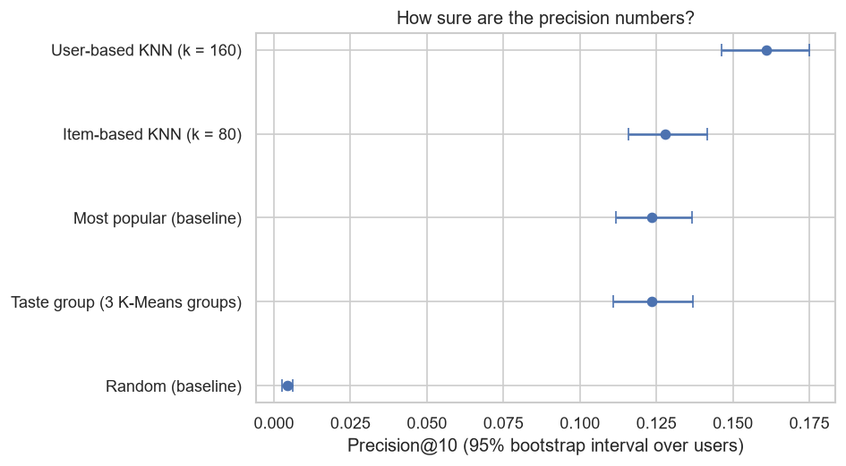
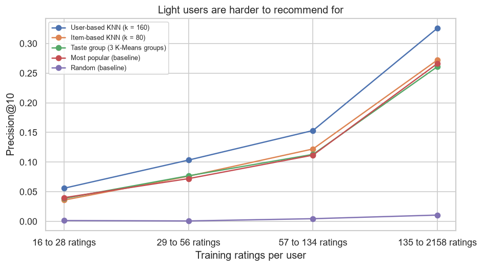
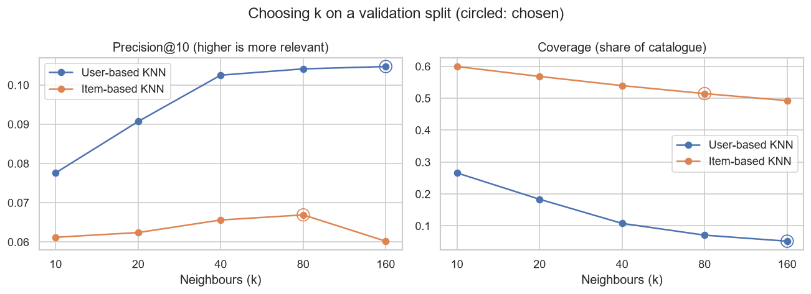
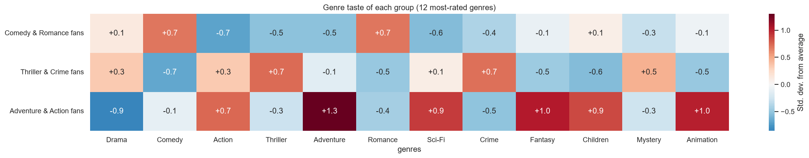

# Results

Produced by `python main.py`. 20% of each user's ratings are hidden (seed 42); a recommendation is relevant if the user rated it 4 stars or more. Only movies with at least 5 training ratings (3,222) can be recommended. The example user is user 143.

## Relevance

### Recommenders on the hidden ratings (10 recommendations per user)

| Method | Precision@10 | Recall@10 | Hit rate | Coverage | Users scored |
| --- | --- | --- | --- | --- | --- |
| User-based KNN (k = 160) | 0.161 | 0.1507 | 0.6767 | 0.0416 | 597 |
| Item-based KNN (k = 80) | 0.1278 | 0.1133 | 0.5879 | 0.4168 | 597 |
| Taste group (3 K-Means groups) | 0.1235 | 0.1094 | 0.5812 | 0.0251 | 597 |
| Most popular (baseline) | 0.1236 | 0.1075 | 0.5745 | 0.0171 | 597 |
| Random (baseline) | 0.0044 | 0.0031 | 0.0419 | 0.8501 | 597 |

## Deeper checks

### Scores with 95% bootstrap intervals over users

| Method | Score | Value | Low | High |
| --- | --- | --- | --- | --- |
| User-based KNN (k = 160) | Precision@10 | 0.161 | 0.1462 | 0.1749 |
| User-based KNN (k = 160) | Recall@10 | 0.1507 | 0.1365 | 0.1647 |
| User-based KNN (k = 160) | Hit rate | 0.6767 | 0.6382 | 0.7119 |
| Item-based KNN (k = 80) | Precision@10 | 0.1278 | 0.1159 | 0.1417 |
| Item-based KNN (k = 80) | Recall@10 | 0.1133 | 0.1021 | 0.1251 |
| Item-based KNN (k = 80) | Hit rate | 0.5879 | 0.5494 | 0.6248 |
| Taste group (3 K-Means groups) | Precision@10 | 0.1235 | 0.1109 | 0.1369 |
| Taste group (3 K-Means groups) | Recall@10 | 0.1094 | 0.0972 | 0.1217 |
| Taste group (3 K-Means groups) | Hit rate | 0.5812 | 0.5394 | 0.6181 |
| Most popular (baseline) | Precision@10 | 0.1236 | 0.1117 | 0.1365 |
| Most popular (baseline) | Recall@10 | 0.1075 | 0.0957 | 0.119 |
| Most popular (baseline) | Hit rate | 0.5745 | 0.5377 | 0.6147 |
| Random (baseline) | Precision@10 | 0.0044 | 0.0027 | 0.006 |
| Random (baseline) | Recall@10 | 0.0031 | 0.0015 | 0.005 |
| Random (baseline) | Hit rate | 0.0419 | 0.0268 | 0.057 |

### Popularity bias: how mainstream each method's picks are

| Method | Median ratings per pick | Picks from the top 10% most rated | Long-tail movies shown |
| --- | --- | --- | --- |
| User-based KNN (k = 160) | 165 | 0.9961 | 0.0048 |
| Item-based KNN (k = 80) | 73 | 0.5716 | 0.4188 |
| Taste group (3 K-Means groups) | 165 | 0.997 | 0.0 |
| Most popular (baseline) | 188 | 1.0 | 0.0 |
| Random (baseline) | 12 | 0.088 | 0.8533 |

### Precision@10 by how many ratings a user gave

| Users | Scored users | User-based KNN (k = 160) | Item-based KNN (k = 80) | Taste group (3 K-Means groups) | Most popular (baseline) | Random (baseline) |
| --- | --- | --- | --- | --- | --- | --- |
| 16 to 28 ratings | 145 | 0.0559 | 0.0359 | 0.0386 | 0.04 | 0.0014 |
| 29 to 56 ratings | 147 | 0.1034 | 0.0762 | 0.0769 | 0.0721 | 0.0007 |
| 57 to 134 ratings | 154 | 0.1532 | 0.1221 | 0.113 | 0.1117 | 0.0045 |
| 135 to 2158 ratings | 151 | 0.3258 | 0.2722 | 0.2609 | 0.2662 | 0.0106 |

## Neighbours

### Choosing the number of neighbours (validation split)

| Method | Neighbours | Precision@10 | Recall@10 | Hit rate | Coverage |
| --- | --- | --- | --- | --- | --- |
| User-based KNN | 10 | 0.0776 | 0.0965 | 0.4661 | 0.2659 |
| User-based KNN | 20 | 0.0907 | 0.106 | 0.5203 | 0.1834 |
| User-based KNN | 40 | 0.1025 | 0.1231 | 0.5644 | 0.1078 |
| User-based KNN | 80 | 0.1041 | 0.1223 | 0.5627 | 0.0709 |
| User-based KNN | 160 | 0.1047 | 0.1208 | 0.5712 | 0.052 |
| Item-based KNN | 10 | 0.0612 | 0.0709 | 0.4051 | 0.5994 |
| Item-based KNN | 20 | 0.0624 | 0.0665 | 0.4068 | 0.5683 |
| Item-based KNN | 40 | 0.0656 | 0.0729 | 0.4186 | 0.5396 |
| Item-based KNN | 80 | 0.0669 | 0.0732 | 0.4068 | 0.5145 |
| Item-based KNN | 160 | 0.0602 | 0.0687 | 0.378 | 0.4927 |

## Taste groups

### Taste groups

| Group | Users | Share | Action | Adventure | Animation | Children | Comedy | Crime | Documentary | Drama | Fantasy | Film-Noir | Horror | IMAX | Musical | Mystery | Romance | Sci-Fi | Thriller | War | Western |
| --- | --- | --- | --- | --- | --- | --- | --- | --- | --- | --- | --- | --- | --- | --- | --- | --- | --- | --- | --- | --- | --- |
| Comedy & Romance fans | 249 | 0.408 | 0.214 | 0.188 | 0.066 | 0.1 | 0.458 | 0.139 | 0.012 | 0.446 | 0.108 | 0.006 | 0.052 | 0.023 | 0.058 | 0.063 | 0.261 | 0.115 | 0.214 | 0.044 | 0.02 |
| Thriller & Crime fans | 233 | 0.382 | 0.37 | 0.239 | 0.035 | 0.048 | 0.257 | 0.242 | 0.008 | 0.476 | 0.078 | 0.011 | 0.078 | 0.042 | 0.02 | 0.1 | 0.137 | 0.187 | 0.366 | 0.077 | 0.025 |
| Adventure & Action fans | 128 | 0.21 | 0.433 | 0.43 | 0.144 | 0.164 | 0.339 | 0.127 | 0.003 | 0.308 | 0.2 | 0.003 | 0.055 | 0.098 | 0.045 | 0.064 | 0.142 | 0.277 | 0.244 | 0.043 | 0.013 |

### Each group's favourite movies

| Group | Favourite movies |
| --- | --- |
| Comedy & Romance fans | Shawshank Redemption, The (1994); Forrest Gump (1994); Fight Club (1999); Schindler's List (1993); American Beauty (1999) |
| Thriller & Crime fans | Shawshank Redemption, The (1994); Pulp Fiction (1994); Silence of the Lambs, The (1991); Fight Club (1999); Matrix, The (1999) |
| Adventure & Action fans | Star Wars: Episode IV - A New Hope (1977); Matrix, The (1999); Raiders of the Lost Ark (Indiana Jones and the Raiders of the Lost Ark) (1981); Shawshank Redemption, The (1994); Lord of the Rings: The Fellowship of the Ring, The (2001) |

### Choosing the number of groups

| k | Stability (mean) | Stability (lowest) |
| --- | --- | --- |
| 3 | 0.671 | 0.214 |
| 4 | 0.444 | 0.34 |
| 5 | 0.382 | 0.275 |
| 6 | 0.37 | 0.247 |

## Example

### One user's recommendations

| Rated highest (training) | User-based KNN | Item-based KNN | Taste group | Most popular |
| --- | --- | --- | --- | --- |
| Forrest Gump (1994) | Shawshank Redemption, The (1994) | Pitch Perfect (2012) | Shawshank Redemption, The (1994) | Shawshank Redemption, The (1994) |
| Sixteen Candles (1984) | Silence of the Lambs, The (1991) | Waitress (2007) | Fight Club (1999) | Pulp Fiction (1994) |
| Walk to Remember, A (2002) | Matrix, The (1999) | Ugly Truth, The (2009) [liked] | Schindler's List (1993) | Silence of the Lambs, The (1991) |
| Legally Blonde (2001) | Schindler's List (1993) | Charlie Wilson's War (2007) | American Beauty (1999) | Matrix, The (1999) |
| Shrek (2001) | Lion King, The (1994) | Education, An (2009) | Usual Suspects, The (1995) | Braveheart (1995) |
| Chasing Liberty (2004) | Braveheart (1995) | Easy A (2010) | Pulp Fiction (1994) | Jurassic Park (1993) |
| Bill Cosby, Himself (1983) | American History X (1998) | She's Out of My League (2010) | Star Wars: Episode V - The Empire Strikes Back (1980) | Fight Club (1999) |
| 13 Going on 30 (2004) | Apollo 13 (1995) | Uptown Girls (2003) [liked] | Raiders of the Lost Ark (Indiana Jones and the Raiders of the Lost Ark) (1981) | Star Wars: Episode IV - A New Hope (1977) |
| 50 First Dates (2004) | Dark Knight, The (2008) | Wedding Crashers (2005) | Silence of the Lambs, The (1991) | Star Wars: Episode V - The Empire Strikes Back (1980) |
| Fired Up (2009) | Back to the Future (1985) | After the Sunset (2004) | Godfather, The (1972) | American Beauty (1999) |
